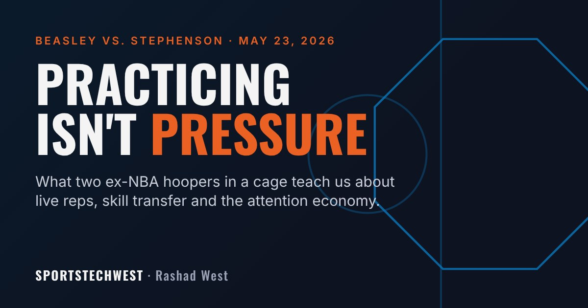

  

## Two Hoopers Walk Into a Cage

On May 23, 2026, at the UFC Apex in Las Vegas, Michael Beasley and Lance Stephenson, two former NBA players and BIG3 teammates, stepped into an MMA cage as the co-main event of [Brand Risk Promotions 14](https://www.tapology.com/fightcenter/events/143561-brandrisk-promotions-14), the influencer fight series run by streamer Adin Ross.

It did not last long. Reports put the finish anywhere from under 30 seconds to 1:26, but every source agrees on how it ended: Beasley ended up on his back and went for a guillotine, Stephenson popped his head out, took Beasley's back, and sank a rear-naked choke. [Tap. First round.](https://clutchpoints.com/nba/lance-stephenson-choking-out-michael-beasley-in-mma-fight-is-craziest-thing-youll-see-today)

Afterward, Beasley gave the most honest postgame quote I have heard all year:

> "Practicing getting choked and getting choked ain't the same!"

And Stephenson gave the most Lance quote possible, pointing back to their basketball history: [*"You can beat me in 1v1, but you wanna fight me?"*](https://x.com/Ballislife/status/2058512397984211428)

Most people watched it as a meme. I watched it as a coach and a data guy. That one Beasley line is a whole player development philosophy, and the sport science backs him up.

---

## Lesson 1: Practice Reps and Live Reps Are Different Data

Beasley was not lying about training. He said he had practiced defending chokes. The problem is that a drill and a fight produce two different kinds of information.

In a drill, your partner gives you the look. In a fight, someone is actively trying to take the thing you are trying to protect. Same technique on paper, completely different decision under load: heart rate up, adrenaline dumping, a real opponent reading *you*.

Researchers have a name for this. **Representative learning design** says practice only transfers to performance when the practice environment keeps the key information and pressures of the real competition (Pinder, Davids, Renshaw & Araújo, 2011). Take away the live opponent and you are training a different skill than the one you will need.

Basketball has the exact same gap:

| What you measure in practice | What actually shows up in a game |
|---|---|
| Spot-up shooting percentage, no defender | Catch-and-shoot percentage with a closeout in your face |
| Ball-handling cone drills | Handling against a pressure defender who has scouted your favorite move |
| Defensive slides on a whistle | Reading a pick-and-roll where the screener slips |
| Free throws at the end of a quiet practice | Free throws down one with the crowd behind the basket |

I wrote about this in [Measurement Does Not Mean Understanding](/blog/Measurement-Does-Not-Mean-Understanding-Part-1/). A number collected in a sterile environment can be accurate and still tell you almost nothing about performance under pressure. The rep count was real. The context was missing.

---

## Lesson 2: Pressure Changes How Skill Works

Here is the part most people miss. Pressure does not just add nerves on top of a skill. It can change how the skill runs.

Beilock and Carr (2001) studied why skilled performers choke. Well-learned skills run mostly on autopilot. Under pressure, people start consciously monitoring each step, and that step-by-step attention can break down a skill that normally runs smoothly. That is what "thinking too much" actually means.

The good news: pressure can be trained. Oudejans and Pijpers (2009) found that skilled athletes who practiced under anxiety-inducing conditions held up better under pressure than those who practiced without it. You do not get comfortable with pressure by avoiding it until game day. You get comfortable by bringing small doses of it into practice.

Beasley's line is the athlete's version of that research. Practicing a defense against a cooperative partner is not the same as defending it while your body is screaming at you.

---

## Lesson 3: Athleticism Transfers. Skill Does Not.

Beasley was the No. 2 pick in the 2008 draft. Stephenson built a career on strength, toughness, and getting under people's skin. Both are elite athletes by any normal standard.

None of that decided the fight. Position did.

That is the part people miss when they say a great athlete can "just pick up" another sport. Research on motor learning shows that transfer between sports depends on how similar the tasks are: the movements, what you have to see, and the decisions you have to make (Rosalie & Müller, 2012). Speed, power and body control carry over. Where your hips go when someone is on your back does not. It has to be built from scratch, under resistance.

Even Beasley's choice showed a basketball brain at work. Going for the guillotine was the aggressive, "take the shot" option. On the court, a missed shot means you get back on defense. In the cage, a missed submission means your opponent is on your back.

This matters for youth sports too. Sampling several sports in childhood is linked to longer participation and a strong base for elite performance later (Côté, Lidor & Hackfort, 2009). That is real. But every new sport still resets the skill clock. The base gets you to the starting line faster. It does not skip the reps.

---

## Lesson 4: The Name of the Promotion Was the Point

The event series is literally called **Brand Risk**. That is not an accident. It is the business model.

Ex-NBA players have something the creator economy wants: name recognition, built-in fan bases, and decades of highlight clips. Streaming promotions have something those players want: a live audience, a payday, and a reason to trend again. A one-minute fight between two former pros generates more clips, reactions, and debate than most full BIG3 games.

Sport management research has been pointing at this for years. An athlete's brand is not only athletic performance. It also includes how they look and how they live off the court, and those pieces carry value of their own (Arai, Ko & Ross, 2014). Fighting on a stream is a bet on the off-court side of the brand.

The price is the "risk" part. You are trading your athletic reputation for attention, live, with no edit button. Beasley lost the fight, but the clip still did numbers, and he immediately pitched a boxing rematch. In the attention economy, losing on camera is often still a win on the spreadsheet.

That is the same tension I wrote about in [Where Does the Value Actually Live?](/blog/Where-Does-the-Value-Actually-Live-Part-2/): the value of an athlete is no longer just what happens between the lines. Former players who understand that are building second careers. The ones who do not are just providing content for someone else's platform.

---

## The Epilogue: Teammates Again

Here is the part that makes it truly a basketball story. Beasley and Stephenson were both on the Miami 305 team that won the 2025 BIG3 championship, and they were back on the same roster for 2026.

Less than a month after the fight, in the June 20 BIG3 season opener against LA Riot, things boiled over again. This time it was not between the two of them. Beasley tangled with Dwight Howard under the basket, and Stephenson later threw a punch after a hard foul. Both were ejected, Miami 305 dropped below the minimum number of active players and [forfeited the game](https://x.com/thebig3/status/2068462888789193082), and Commissioner Clyde Drexler [suspended both players](https://larrybrownsports.com/basketball/lance-stephenson-michael-beasley-suspended-big3/759023), saying fighting "of any kind will not be tolerated."

So the same two players went from fighting each other for a promotion that sells risk, to getting suspended for fighting on a court where risk costs you games. Same behavior, opposite incentives. Context changes the value of the exact same action.

---

## Try It This Week: Measure Your Pressure Gap

This is where basketball becomes math. Pick one skill and measure it two ways:

1. **Practice number:** 20 free throws at the start of practice, fresh and quiet. Write down the makes.
2. **Pressure number:** 20 free throws after a hard conditioning block, one at a time, with a consequence on every miss (the team runs, or you lose a point in a scrimmage). Write down the makes.

Then do the math:

**Pressure Gap = Practice % − Pressure %**

If you make 16 of 20 in practice (80%) and 12 of 20 under pressure (60%), your Pressure Gap is 20 points. That number is more useful than either percentage on its own. It tells you how much of your skill survives when it matters.

Run it once a week for a month. If the gap is shrinking, your practice is starting to look like the game. If it is not, add more live resistance to your practice, not more reps of the same drill.

---

## What I Am Taking From It

1. **Train against live resistance.** Your drill numbers are the floor, not the forecast.
2. **Bring pressure into practice.** Small doses now beat a big dose on game day.
3. **Respect the skill clock.** Athleticism buys speed of learning, not a shortcut past the reps.
4. **Know which game you are playing.** The attention economy rewards things the scoreboard punishes. Be intentional about which one you are building for.

Beasley said it better than any coaching clinic could. Practicing getting choked and getting choked ain't the same. Build your practice so the game never feels like the first time.

---

## Research

- Arai, A., Ko, Y. J., & Ross, S. (2014). Branding athletes: Exploration and conceptualization of athlete brand image. *Sport Management Review, 17*(2), 97–106. [doi:10.1016/j.smr.2013.04.003](https://doi.org/10.1016/j.smr.2013.04.003)
- Beilock, S. L., & Carr, T. H. (2001). On the fragility of skilled performance: What governs choking under pressure? *Journal of Experimental Psychology: General, 130*(4), 701–725.
- Côté, J., Lidor, R., & Hackfort, D. (2009). ISSP position stand: To sample or to specialize? Seven postulates about youth sport activities that lead to continued participation and elite performance. *International Journal of Sport and Exercise Psychology, 7*(1), 7–17.
- Oudejans, R. R. D., & Pijpers, J. R. (2009). Training with anxiety has a positive effect on expert perceptual-motor performance under pressure. *Quarterly Journal of Experimental Psychology, 62*(8), 1631–1647.
- Pinder, R. A., Davids, K., Renshaw, I., & Araújo, D. (2011). Representative learning design and functionality of research and practice in sport. *Journal of Sport & Exercise Psychology, 33*(1), 146–155. [doi:10.1123/jsep.33.1.146](https://doi.org/10.1123/jsep.33.1.146)
- Rosalie, S. M., & Müller, S. (2012). A model for the transfer of perceptual-motor skill learning in human behaviors. *Research Quarterly for Exercise and Sport, 83*(3), 413–421.

## News Sources

[Tapology](https://www.tapology.com/fightcenter/bouts/1136143-brandrisk-promotions-14-michael-beasley-vs-lance-stephenson), [Bloody Elbow](https://bloodyelbow.com/2026/05/24/michael-beasley-vs-lance-stephenson-fight-result-brand-risk-promotions-mma-fight-ends-in-shock-submission/), [Yahoo Sports](https://sports.yahoo.com/articles/brand-risk-14-live-blog-070440618.html), [ClutchPoints](https://clutchpoints.com/nba/lance-stephenson-choking-out-michael-beasley-in-mma-fight-is-craziest-thing-youll-see-today), [Larry Brown Sports](https://larrybrownsports.com/basketball/lance-stephenson-michael-beasley-suspended-big3/759023), [BIG3](https://x.com/thebig3/status/2068462888789193082).
